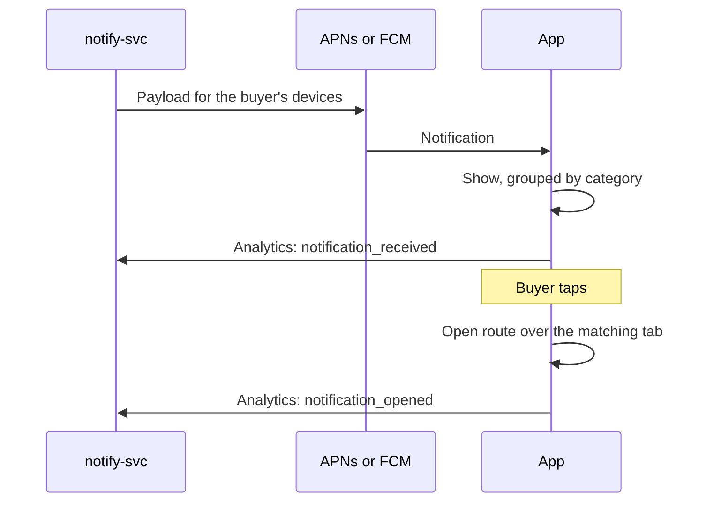

| Status | Stable |
| -- | -- |
| Version | 1.2 |
| Updated | 2026-07-14 |
| Owner | DemoPeggy |
| Applies to | Every push notification `notify-svc` sends to the app ([ADR-039](@ADR-039)) |

## Overview

`notify-svc` sends one payload shape to both platforms. It checks the buyer's category preferences ([RFC-066](@RFC-066)) before sending, then converts the payload to APNs or FCM format. The app reads only the `demomart` object; the visible text comes from the platform fields so notifications show even when the app is not running.

## Fields

| Field | Type | Required | Description |
| -- | -- | -- | -- |
| `notification_id` | string (UUIDv7) | yes | Unique; the app reports it in analytics and ignores duplicates |
| `category` | enum | yes | `order_updates`, `price_drops`, `back_in_stock`, `messages`, `promotions` |
| `title` | string, at most 50 characters | yes | Shown in bold |
| `body` | string, at most 150 characters | yes | Shown below the title |
| `route` | string | yes | Screen to open, a path from [SPEC-071](@SPEC-071) |
| `image_url` | string | no | Product image, 600 by 600, AVIF or WebP ([RFC-070](@RFC-070)) |
| `collapse_key` | string | no | Replaces an earlier notification with the same key, for example one per order |
| `expires_at` | timestamp | no | Not delivered after this time; price drops expire after 24 hours |
| `sent_at` | timestamp | yes | When `notify-svc` sent it |

## Example

```json
{
  "notification_id": "01924f6e-8c2a-7d41-9b0e-3a6f1c2d4e55",
  "category": "order_updates",
  "title": "Your order is out for delivery",
  "body": "2 items from a garden furniture seller arrive today between 14:00 and 16:00.",
  "route": "/orders/o_7731/tracking",
  "image_url": "https://img.example.com/p/8c1f2a/main?w=600&h=600",
  "collapse_key": "order-o_7731",
  "expires_at": "2026-07-14T20:00:00Z",
  "sent_at": "2026-07-14T08:12:31Z"
}
```

On iOS the object is sent as:

```json
{
  "aps": {
    "alert": { "title": "Your order is out for delivery", "body": "2 items from a garden furniture seller arrive today between 14:00 and 16:00." },
    "thread-id": "order_updates",
    "mutable-content": 1
  },
  "demomart": { "notification_id": "01924f6e-8c2a-7d41-9b0e-3a6f1c2d4e55", "route": "/orders/o_7731/tracking" }
}
```

On Android, `category` becomes the notification channel id, and `collapse_key` the FCM collapse key.

## Handling in the app



## Limits

| Category | At most per buyer | Quiet time |
| -- | -- | -- |
| `order_updates` | no limit | none |
| `price_drops` | 1 per day | 21:00 to 08:00 local time |
| `back_in_stock` | 2 per day | 21:00 to 08:00 local time |
| `messages` | no limit | none |
| `promotions` | 2 per week | 20:00 to 10:00 local time |

## Version history

| Version | Date | Change |
| -- | -- | -- |
| 1.0 | 2025-12-01 | First version, routes as `demomart://` links |
| 1.1 | 2026-02-03 | Routes as paths from the shared routing table |
| 1.2 | 2026-07-14 | `category` required; limits per category |
