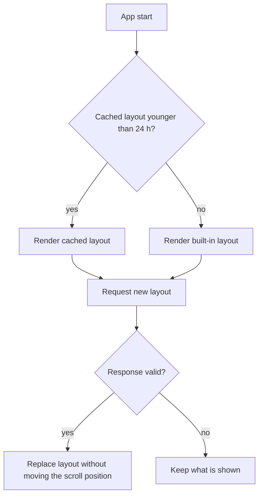

| Status | Stable |
| -- | -- |
| Version | 1.3 |
| Updated | 2026-08-04 |
| Owner | DemoLaura |
| Applies to | `GET /v2/home` from `home-svc` and the app's home screen renderer |

## Overview

The home screen is a list of sections sent by `home-svc` ([RFC-068](@RFC-068)). The app renders known section types in order and skips unknown ones, so a new section type can ship in a new app release before `home-svc` sends it to everyone.

## Document

| Field | Type | Required | Description |
| -- | -- | -- | -- |
| `layout_id` | string | yes | Identifies the layout for analytics and experiments |
| `ttl_seconds` | integer, 60 to 3,600 | yes | How long the app may show this layout before refreshing |
| `min_app_version` | string | no | Older apps get the built-in layout instead |
| `sections` | array, 1 to 30 items | yes | The sections, in display order |

## Section types

| Type | Since app | Fields | Notes |
| -- | -- | -- | -- |
| `search_bar` | 5.5 | none | Always first when present |
| `banner` | 5.5 | `image`, `target`, `alt` | Image 1,200 by 400; `alt` is read by screen readers |
| `product_row` | 5.5 | `title`, `source`, `limit` | `source` is `reco:personal`, `reco:trending`, `history` or `list:{id}` |
| `category_grid` | 5.5 | `categories` | 4 to 12 category slugs |
| `seller_spotlight` | 5.9 | `seller`, `title` | One seller store with 6 products |
| `order_status` | 5.11 | none | Next delivery of the signed-in buyer, hidden when there is none |
| `voucher` | 5.13 | `code`, `text`, `expires_at` | From promotions ([SPEC-053](@SPEC-053)) |

## Example

```json
{
  "layout_id": "home-2026-08-03-a",
  "ttl_seconds": 900,
  "min_app_version": "5.5",
  "sections": [
    { "type": "search_bar" },
    { "type": "order_status" },
    { "type": "banner", "image": "https://img.example.com/c/summer.avif", "target": "/campaign/summer", "alt": "Summer garden sale, up to 30 % off" },
    { "type": "product_row", "title": "Picked for you", "source": "reco:personal", "limit": 12 },
    { "type": "category_grid", "categories": ["garden", "kitchen", "lighting", "toys"] },
    { "type": "product_row", "title": "Recently viewed", "source": "history", "limit": 10 }
  ]
}
```

## Rendering



* A section that fails to load its data (for example a product row whose source returns nothing) is hidden; the rest stays.
* The app never shows more than 30 sections, and drops sections beyond the first 3 banners.
* `target` values are routes from [SPEC-071](@SPEC-071).

## Version history

| Version | Date | Change |
| -- | -- | -- |
| 1.0 | 2026-03-10 | Four section types |
| 1.1 | 2026-05-05 | `seller_spotlight` |
| 1.2 | 2026-06-02 | `order_status` |
| 1.3 | 2026-08-04 | `voucher`; `alt` required on banners |
