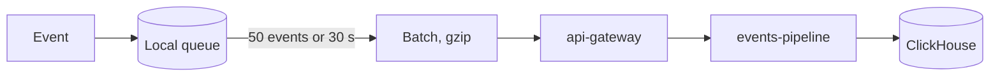

| Status | Stable |
| -- | -- |
| Version | 2.0 |
| Updated | 2026-05-18 |
| Owner | DemoMike |
| Applies to | Analytics events sent by the DemoMart app on iOS and Android |

## Overview

The app sends analytics events in the common analytics schema ([SPEC-020](@SPEC-020)), batched and compressed, to the events pipeline. This specification lists the app's events and the fields it adds. Events carry no names, addresses or free text typed by the buyer; the buyer is identified only by a pseudonymous id.

## Common app fields

| Field | Type | Example | Description |
| -- | -- | -- | -- |
| `app_version` | string | `5.12.0` | Release of the app |
| `platform` | enum | `ios` | `ios` or `android` |
| `os_version` | string | `18.4` | Operating system version |
| `device_class` | enum | `mid_android` | One of the five classes in [SPEC-076](@SPEC-076) |
| `session_id` | string | `s_9f2c1d` | New after 30 minutes in the background |
| `screen` | string | `product` | Screen id from [SPEC-069](@SPEC-069) |
| `network` | enum | `cellular` | `wifi`, `cellular` or `offline` |

## Events

| Event | When | Extra fields |
| -- | -- | -- |
| `app_start` | First frame after a start | `start_type` (cold or warm), `duration_ms`, `phases` |
| `screen_view` | A screen becomes visible | `previous_screen`, `route` |
| `home_layout_shown` | Home screen rendered | `layout_id`, `from_cache` |
| `product_view` | Product screen visible | `product_id`, `source` (home, search, link, push) |
| `add_to_cart` | Cart line added or changed | `product_id`, `quantity`, `offline` |
| `checkout_step` | Each checkout step | `step`, `payment_method` |
| `notification_received` | Push arrives | `notification_id`, `category` |
| `notification_opened` | Push tapped | `notification_id`, `route` |
| `review_prompt_shown` | Store prompt shown | `trigger` |
| `sign_in` | Sign-in completed | `method` (password, biometric) |

## Example

```json
{
  "event": "app_start",
  "event_id": "01925a3b-1f00-7c2e-8d11-5e4b0a9c7f21",
  "time": "2026-05-18T07:41:09.512Z",
  "buyer": "pb_3c81f0",
  "app_version": "5.10.0",
  "platform": "android",
  "os_version": "14",
  "device_class": "low_android",
  "session_id": "s_9f2c1d",
  "screen": "home",
  "network": "cellular",
  "start_type": "cold",
  "duration_ms": 2410,
  "phases": { "process": 540, "di": 330, "home": 760, "image": 470, "draw": 310 }
}
```

## Sending

* Events are queued in the local store ([SPEC-074](@SPEC-074)) and sent in batches of up to 50, or every 30 seconds, gzip-compressed.
* Offline, the queue keeps up to 5,000 events or 7 days, whichever comes first; older events are dropped.
* A buyer who opts out of analytics in settings sends only `app_start` without the buyer id, for crash and performance monitoring.



## Version history

| Version | Date | Change |
| -- | -- | -- |
| 1.0 | 2025-03-03 | First app events |
| 1.4 | 2025-11-24 | `app_start` with phases |
| 2.0 | 2026-05-18 | Moved to the common analytics schema; screen ids from the navigation map |
