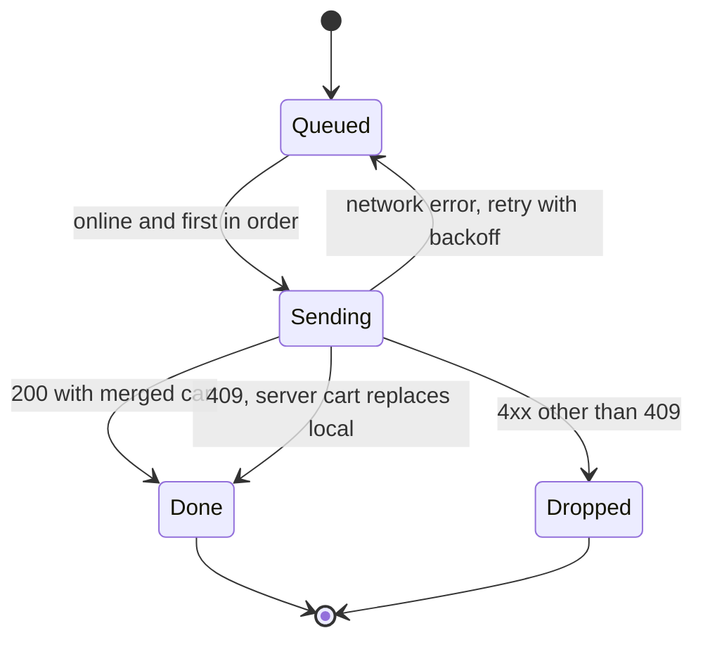

| Status | Stable |
| -- | -- |
| Version | 1.1 |
| Updated | 2026-03-02 |
| Owner | DemoNina |
| Applies to | Data the DemoMart app keeps on the device, on iOS and Android |

## Overview

The app keeps one SQLite database per signed-in buyer, plus an image cache on disk. The database holds what the app needs without a connection: the cart and its outbox ([RFC-065](@RFC-065)), saved products, recent orders, the last home layout ([SPEC-072](@SPEC-072)) and the analytics queue ([SPEC-073](@SPEC-073)). Nothing in it is the source of truth; the server always wins on conflict.

## Tables

| Table | Holds | Limit | Cleared when |
| -- | -- | -- | -- |
| `cart_line` | Cart lines with server version | 200 lines | Order placed, or sign-out |
| `cart_outbox` | Queued cart changes, in order | 500 operations | Sent and acknowledged |
| `saved_product` | Saved products, with last seen price | 1,000 | Sign-out |
| `order_summary` | Last 50 orders, for offline viewing | 50 | Sign-out |
| `home_layout` | Last home layout document | 1 | Older than 24 hours |
| `analytics_queue` | Unsent analytics events | 5,000 or 7 days | Sent |
| `kv` | Small settings: last tab, feature flag snapshot | 200 keys | Never, except sign-out |

## Schema of the cart tables

```sql
CREATE TABLE cart_line (
  id            TEXT PRIMARY KEY,
  product_id    TEXT NOT NULL,
  variant_id    TEXT NOT NULL,
  quantity      INTEGER NOT NULL CHECK (quantity BETWEEN 1 AND 99),
  unit_price    INTEGER NOT NULL,          -- minor units, see ADR-020
  currency      TEXT NOT NULL,
  version       INTEGER NOT NULL,          -- server version, 0 before first sync
  updated_at    INTEGER NOT NULL           -- epoch milliseconds, device clock
);

CREATE TABLE cart_outbox (
  seq           INTEGER PRIMARY KEY AUTOINCREMENT,
  op            TEXT NOT NULL CHECK (op IN ('upsert', 'remove')),
  line_id       TEXT NOT NULL,
  payload       TEXT NOT NULL,             -- JSON
  base_version  INTEGER NOT NULL,
  attempts      INTEGER NOT NULL DEFAULT 0
);
```

Money follows [ADR-020](@ADR-020): integer minor units with a currency code.

## Outbox processing



Backoff starts at 2 seconds and doubles to at most 5 minutes. After 10 failed attempts the operation is dropped and the cart is reloaded from the server.

## Security

| Data | Protection |
| -- | -- |
| Database file | iOS data protection class "complete until first user authentication"; Android file-based encryption |
| Tokens | Never in SQLite: iOS Keychain, Android Keystore-backed encrypted preferences |
| Payment data | Never stored on the device; only the last four digits of saved cards, from the server |
| Addresses | Not stored; fetched at checkout |

## Migrations

Schema changes ship as numbered migrations run on start, inside one transaction. A failed migration deletes the database and starts empty; the next sync refills it. Migrations must run in under 200 ms on low-end Android, which the start time budget includes ([RFC-067](@RFC-067)).

## Version history

| Version | Date | Change |
| -- | -- | -- |
| 1.0 | 2026-01-20 | Cart, outbox, saved products, analytics queue |
| 1.1 | 2026-03-02 | `home_layout` and `order_summary` |
