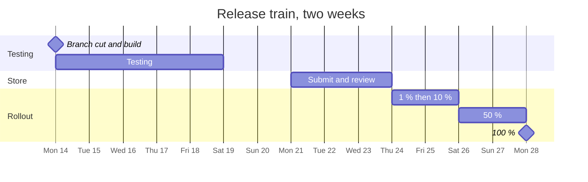

| Status | Stable |
| -- | -- |
| Version | 3.0 |
| Updated | 2026-09-14 |
| Owner | DemoMike |
| Applies to | Every release of the DemoMart app, from branch cut to 100 % rollout |

## Overview

A release of the app follows a two-week train: branch cut on Monday, five testing days, store submission, then a staged rollout ([RFC-072](@RFC-072) kept this cadence). This checklist is copied into every release's tracking issue and ticked there. Version 3.0 shortened it from 41 to 26 items after [RN-062](@RN-062): what can be checked by the pipeline is no longer on the list.

## Branch cut

- [ ] Release branch `release/5.N` cut from main at 10:00
- [ ] Version and build number set; changelog generated from merged changes
- [ ] All new features off by default or behind a flag ([ADR-022](@ADR-022))
- [ ] Start benchmark within budget on all reference devices ([RFC-067](@RFC-067))
- [ ] Download size grew by at most 1.5 MB, or the growth is explained ([RN-068](@RN-068))

## Testing

- [ ] Smoke test on one low-end Android, one recent Android, one older iPhone, one recent iPhone
- [ ] Sign in with password and with biometrics ([RFC-069](@RFC-069))
- [ ] Add to cart offline, go online, check the merged cart ([RFC-065](@RFC-065))
- [ ] Checkout with card, saved card and one local payment method ([SPEC-049](@SPEC-049))
- [ ] Deep links from an email, a push and a web page open the right screen ([SPEC-071](@SPEC-071))
- [ ] Push notification of each category arrives and opens its route ([SPEC-070](@SPEC-070))
- [ ] Android: kill the app in the background during sync and checkout, then reopen
- [ ] Screen reader pass over home, product, cart and checkout ([SPEC-077](@SPEC-077))
- [ ] No new crash cluster in internal testing with more than 5 users

## Store submission

- [ ] Release notes in all 7 store languages
- [ ] Screenshots unchanged, or new ones approved
- [ ] Privacy labels and data safety form match the analytics events ([SPEC-073](@SPEC-073))
- [ ] Submitted to both stores by Monday 16:00 of week 2

## Staged rollout

- [ ] 1 %: crash-free sessions at least 99.7 % after 24 hours
- [ ] 10 %: no new crash cluster above 200 users
- [ ] 50 %: orders per session within 2 % of the previous release
- [ ] 100 %: rollout complete, release marked in the dashboard

## Halting a rollout

| Signal | Action |
| -- | -- |
| Crash-free sessions below 99.5 % | Halt the rollout at once |
| A crash cluster above 500 users | Halt, then hotfix from the release branch |
| Checkout success 3 % below the previous release | Halt and compare by payment method |
| Store review rejected | Fix on the release branch; testing items stay ticked unless code changed |

## Version history

| Version | Date | Change |
| -- | -- | -- |
| 1.0 | 2025-04-07 | First checklist, 33 items |
| 2.0 | 2026-01-12 | Two-week train, staged rollout, 41 items |
| 3.0 | 2026-09-14 | 26 items; pipeline checks removed; Android process-death check added |
