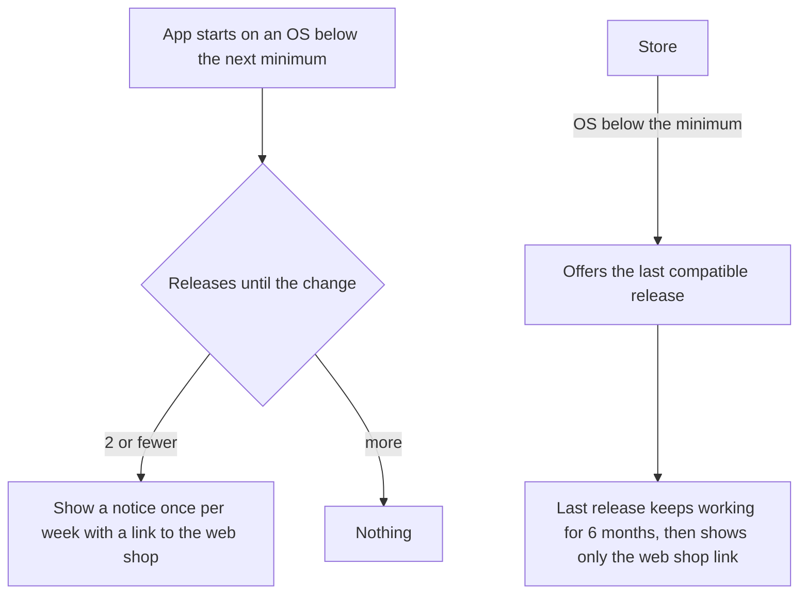

| Status | Stable |
| -- | -- |
| Version | 2.0 |
| Updated | 2026-10-12 |
| Owner | DemoNina |
| Applies to | The DemoMart app on iOS and Android |

## Overview

The app supports the operating system versions that together cover at least 95 % of app users and 97 % of app orders. We review the minimum once a year, in October, from the usage measured in [RN-066](@RN-066), and announce a change at least two releases before it takes effect.

## Current and next minimum

| Platform | Minimum today | Minimum from app 5.25 (Q1 2027) | Users below the new minimum | Their share of app orders |
| -- | -- | -- | -- | -- |
| iOS | 16 | 17 | 2.1 % | 1.4 % |
| Android | 10 (API 29) | 12 (API 31) | 2.8 % | 1.9 % |

Together the new minimums cover 95.1 % of app users and 96.7 % of app orders. The order coverage is slightly under the 97 % target; we accept it because supporting iOS 16 costs a separate photo picker and live activity path.

## Device classes

The app sorts devices into five classes at first start, from memory and a 200 ms CPU benchmark. Image formats ([RFC-070](@RFC-070)), animation and prefetching depend on the class, and analytics events carry it ([SPEC-073](@SPEC-073)).

| Class | Id | Rule | Share of app users |
| -- | -- | -- | -- |
| Low-end Android | `low_android` | Under 4 GB memory or benchmark below 300 | 12.6 % |
| Mid-range Android | `mid_android` | 4 to 6 GB and benchmark 300 to 700 | 26.3 % |
| Recent Android | `recent_android` | Over 6 GB or benchmark over 700 | 18.4 % |
| Older iPhone | `older_iphone` | Benchmark below 900 | 11.5 % |
| Recent iPhone | `recent_iphone` | Benchmark 900 and over | 31.2 % |

```kotlin
fun deviceClass(memoryGb: Double, score: Int): DeviceClass = when {
    memoryGb < 4 || score < 300 -> DeviceClass.LOW_ANDROID
    memoryGb <= 6 && score <= 700 -> DeviceClass.MID_ANDROID
    else -> DeviceClass.RECENT_ANDROID
}
```

## What happens to older versions



The last compatible release keeps working against the API for six months, because the public API versions stay supported that long ([SPEC-042](@SPEC-042)).

## Version history

| Version | Date | Change |
| -- | -- | -- |
| 1.0 | 2025-10-13 | iOS 16, Android 10 |
| 1.1 | 2026-01-12 | Device classes |
| 2.0 | 2026-10-12 | iOS 17 and Android 12 from app 5.25 |
