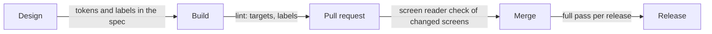

| Status | Stable |
| -- | -- |
| Version | 1.2 |
| Updated | 2026-06-22 |
| Owner | DemoJudy |
| Applies to | Every screen of the DemoMart app on iOS and Android |

## Overview

Every screen of the app meets WCAG 2.2 level AA as it applies to native apps. This specification turns the guidelines into concrete rules for our components, so that a reviewer can check a screen in minutes. Design tokens carry the colours and text sizes that meet them ([ADR-025](@ADR-025)).

## Requirements

| Area | Requirement | How we check |
| -- | -- | -- |
| Text size | All text scales with the system setting up to 200 %, without cutting off | Largest system size on the smallest supported screen |
| Contrast | Text 4.5 to 1, large text and icons 3 to 1 against their background | Token pairs are validated in the design system build |
| Touch targets | At least 44 by 44 points on iOS, 48 by 48 dp on Android | Layout lint rule |
| Screen readers | Every control has a label, role and state; images have a description or are hidden | VoiceOver and TalkBack pass per release ([SPEC-075](@SPEC-075)) |
| Focus order | Follows the visual order; sheets and dialogs trap focus until closed | Keyboard and switch control pass |
| Motion | Animations respect "reduce motion"; nothing flashes more than 3 times a second | Reduce motion on in the release pass |
| Colour | Never the only carrier of meaning: prices on sale also show the old price struck through | Design review |
| Time limits | No checkout step times out in under 20 minutes, and the buyer can extend it | Checkout specification ([SPEC-045](@SPEC-045)) |

## Labels for common components

| Component | Screen reader label | Example |
| -- | -- | -- |
| Product card | Title, price, rating, "sponsored" if so | "Oak side table, 89 euros, rated 4.6 of 5" |
| Add to cart button | Action and product | "Add Oak side table to cart" |
| Quantity stepper | Value and bounds | "Quantity 2, adjustable, 1 to 99" |
| Banner | The `alt` text of the section ([SPEC-072](@SPEC-072)) | "Summer garden sale, up to 30 % off" |
| Rating stars | Value as text | "4.6 of 5 stars, 212 ratings" |

```swift
Button(action: { cart.add(product) }) {
    Image(systemName: "cart.badge.plus")
}
.accessibilityLabel("Add \(product.title) to cart")
.frame(minWidth: 44, minHeight: 44)
```

## Review flow



## Checklist for a new screen

- [ ] Works at 200 % text size on the smallest supported screen
- [ ] All colours from design tokens
- [ ] All controls labelled; decorative images hidden from screen readers
- [ ] Focus order checked with VoiceOver and TalkBack
- [ ] No information by colour alone
- [ ] Reduce motion respected

## Version history

| Version | Date | Change |
| -- | -- | -- |
| 1.0 | 2025-09-01 | WCAG 2.1 AA |
| 1.1 | 2026-01-26 | WCAG 2.2 AA; target sizes |
| 1.2 | 2026-06-22 | Labels for banners from the home layout |
