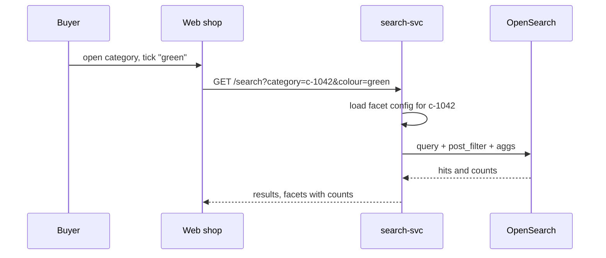

| Status | Implemented |
| -- | -- |
| Created | 2025-08-11 |
| Authors | DemoJudy |
| Reviewers | DemoOscar, DemoGrace |
| Target | Q4 2025 |
| Decision | No ADR needed; configuration format in [SPEC-062](@SPEC-062) |

## Summary

Show filters (facets) with value counts on every category page and on search results: price, size, brand, colour and the attributes that matter in each category, configured per category without a code change.

## Motivation

Category pages list up to 40,000 products sorted by popularity, with no way to narrow them. 63 % of category-page sessions never go past the second page of results, and session recordings show buyers switching to the search box to type "blue" or "under 50". Product listings already carry structured attributes ([SPEC-079](@SPEC-079)); search does not use them.

## Proposal

### Aggregations next to the query

`search-svc` sends one request that returns both the hits and the facet counts. Selected values filter in a `post_filter`, and each facet's counts are filtered by the other facets' selections only, so a facet still shows counts for its own other values ("multi-select" behaviour). In the example the buyer chose green and under 50.00.

```json
{
  "query": { "term": { "category_ids": "c-1042" } },
  "post_filter": {
    "bool": {
      "filter": [
        { "terms": { "attributes.colour": ["green"] } },
        { "range": { "price_minor": { "lt": 5000 } } }
      ]
    }
  },
  "aggs": {
    "colour": {
      "filter": { "range": { "price_minor": { "lt": 5000 } } },
      "aggs": { "values": { "terms": { "field": "attributes.colour", "size": 20 } } }
    },
    "price": {
      "filter": { "terms": { "attributes.colour": ["green"] } },
      "aggs": {
        "ranges": {
          "range": {
            "field": "price_minor",
            "ranges": [{ "to": 2500 }, { "from": 2500, "to": 5000 }, { "from": 5000, "to": 10000 }, { "from": 10000 }]
          }
        }
      }
    }
  }
}
```

### Per-category configuration

Merchandisers choose which attributes appear as facets, their order and their display type in a YAML file per category tree, reviewed like code ([SPEC-062](@SPEC-062)). `search-svc` loads it at start and on change.



## Alternatives

| Option | Counts per value | Config without deploy | Why not |
| -- | -- | -- | -- |
| **Aggregations per request** | **yes, exact** | **yes** | Chosen |
| Precomputed facet counts per category, nightly | stale | yes | Wrong counts after price or stock changes |
| Client-side filtering of 200 results | partial | no | Misses most of a 40,000-product category |

## Rollout

- [X] Price, brand and rating facets on five categories
- [X] Attribute facets for all categories with configuration
- [X] Facets on search results pages
- [X] Usage study after six weeks ([RN-058](@RN-058))
- [ ] Show all values on the app ([SPEC-069](@SPEC-069))

## Open questions

* Should facet order adapt to the query? Deferred until the usage study is repeated with "Delivery by date" moved up.
