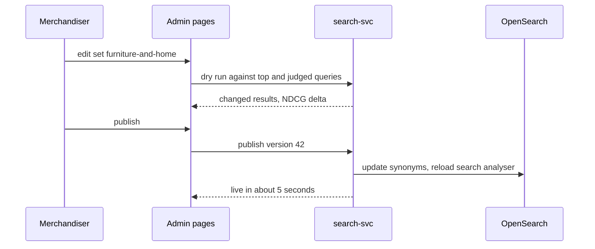

| Status | In review |
| -- | -- |
| Created | 2026-02-02 |
| Authors | DemoJudy |
| Reviewers | DemoNina, DemoGrace |
| Target | Q2 2026 |
| Decision | Pending review |

## Summary

Let merchandisers add, test and publish synonyms per category from Seller Hub's internal admin pages, instead of asking engineers to edit the synonym file and redeploy `search-svc`.

## Motivation

Vocabulary gaps cause 34 % of the remaining zero-result searches ([RN-055](@RN-055)): buyers type "settee", listings say "sofa". The synonym file ([SPEC-063](@SPEC-063)) fixes such gaps, but it has 1,140 entries edited by three engineers, requests wait a median of 9 days, and two bad entries in 2025 ("pen" to "pendant", "tablet" to "pill") made whole categories return wrong results until the next deploy.

## Proposal

### Synonym sets per category tree

Synonyms move from one global file to sets attached to category trees, so "tablet" can mean a computer in Electronics and a pill box in Health without conflict. A global set remains for words that mean the same everywhere.

```yaml
set: furniture-and-home
category: c-1000
rules:
  - type: equivalent
    terms: [sofa, couch, settee]
  - type: one_way
    from: [loveseat]
    to: [sofa]
  - type: equivalent
    terms: [wardrobe, armoire, closet]
```

### Test before publish

Every change runs against the 200 most frequent queries of the category and the judged queries of [SPEC-067](@SPEC-067). The editor shows which results change and blocks publishing if NDCG@10 drops by more than 0.01 for the category.

### Publishing without a deploy

OpenSearch supports updateable search-time synonym filters. `search-svc` writes the published set to the cluster and reloads the analyser; indexing is not affected.



## Alternatives

| Option | Lead time | Risk of a bad rule | Why not |
| -- | -- | -- | -- |
| File in the repository (today) | 9 days median | reviewed, but untested | Slow; one global set |
| Learned synonyms from query reformulations | automatic | high without review | Kept as a suggestion source, not as the publisher |
| **Sets per category, tested, live reload** | **minutes** | **tested against judged queries** | Proposed |

## Rollout

- [ ] Split the global file into category sets, no behaviour change
- [ ] Admin editor with dry run, internal only
- [ ] Live reload of search-time analysers
- [ ] Suggested synonyms from "searched again with" pairs in the analytics events ([SPEC-065](@SPEC-065))

## Open questions

* Who may publish to the global set? The draft says only the search team.
* Should rules expire if they change no result for 90 days?
