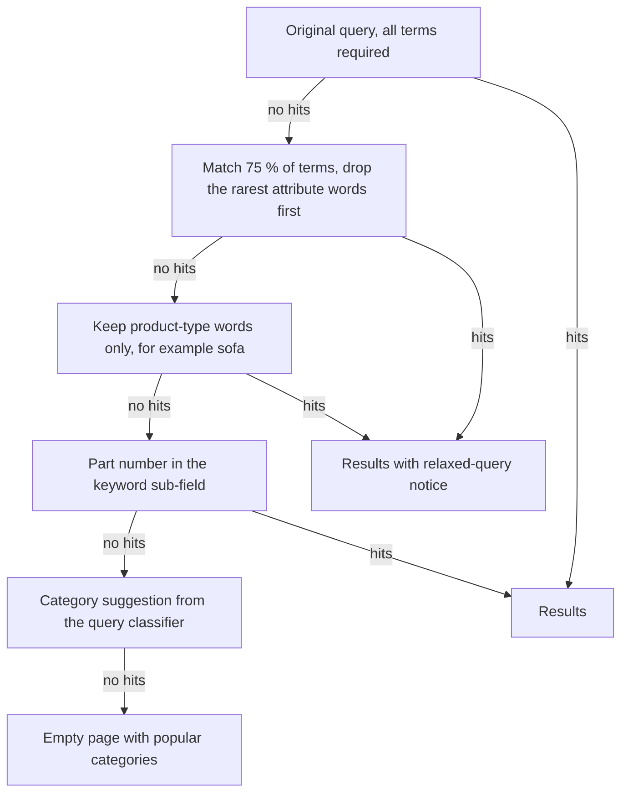

| Status | Implemented |
| -- | -- |
| Created | 2026-02-09 |
| Authors | DemoJudy, DemoOscar |
| Reviewers | DemoNina |
| Target | Q1 2026 |
| Decision | Within [ADR-012 Use OpenSearch for product search](@ADR-012) |

## Summary

When a search finds nothing, relax it step by step on the server and show the closest results with a short explanation ("No exact match for all words. Showing results for green velvet sofa"), instead of an empty page.

## Motivation

The zero-result rate is 1.9 % of all searches, about 400,000 empty pages a month ([RN-055](@RN-055)). 27 % of them come from queries with too many attributes and 9 % from part numbers. After an empty page, 91 % of buyers leave search, and a third of them leave the site within a minute.

## Proposal

### Relaxation ladder

`search-svc` tries each step only if the previous one returned nothing, and stops at the first step with results. All steps run within one request budget of 200 ms ([SPEC-059](@SPEC-059)); steps after the first take about 25 ms each.



### Telling the buyer

A relaxed result always says what was dropped, and offers the original query as a link to search again "with all words". The response carries the step in `relaxation` so the web shop and app can phrase it ([SPEC-059](@SPEC-059)):

```json
{
  "query": "green velvet 3 seater sofa with storage",
  "relaxation": {
    "step": "partial_match",
    "used_terms": ["green", "velvet", "sofa"],
    "dropped_terms": ["3", "seater", "with", "storage"]
  },
  "total": 214
}
```

### Measuring it

A relaxed search logs `zero_result_recovered` in the analytics events ([SPEC-065](@SPEC-065)), so the zero-result rate keeps counting the original miss and we can see how often recovery helps.

## Alternatives

| Option | Empty pages avoided | Risk | Why not |
| -- | -- | -- | -- |
| **Relaxation ladder** | **about 80 %** | Irrelevant results if relaxed too far | Chosen, with an explicit notice |
| Always OR all terms | almost all | Floods results with partial matches | Hurts precision for every query |
| Show bestsellers instead | 100 % | Unrelated to the query | Buyers ignore them; 2 % click-through in a test |

## Rollout

- [X] Ladder behind a flag on web, 2026-02-23
- [X] Notice text and "all words" link on web and app
- [X] Part-number sub-field in the index ([SPEC-060](@SPEC-060), version 1.4)
- [X] 100 % on 2026-03-16: 79 % of former empty pages now show results, and 31 % of those get a click

## Open questions

* Should the ladder learn which words to drop from past reformulations? Possible later, with the logs this change produces.
