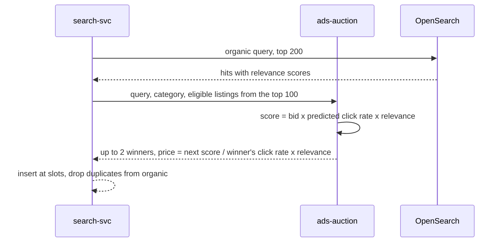

| Status | In review |
| -- | -- |
| Created | 2026-09-07 |
| Authors | DemoJudy |
| Reviewers | DemoHeidi, DemoGrace, DemoPeggy |
| Target | Q1 2027 |
| Decision | Pending review; slot rules drafted in [SPEC-068](@SPEC-068) |

## Summary

Let sellers pay to show a listing in clearly labelled slots on search results pages, priced per click in a second-price auction, without changing the organic ranking around them.

## Motivation

Sellers ask for a way to promote new listings, which the learned ranking shows less often until they have sales history ([RN-054](@RN-054)). A sponsored slot gives them that, and it gives DemoCompany a revenue line besides commission. The risk is buyer trust: if sponsored listings are irrelevant or unlabelled, search quality drops for everyone.

## Proposal

### Slots

* Up to two sponsored slots per results page: positions 3 and 9 on web, 2 and 8 on the app ([SPEC-068](@SPEC-068)).
* Every sponsored listing carries a visible "Sponsored" label and an explanation on tap.
* A listing can fill a slot only if it would rank in the organic top 100 for the query; relevance is a gate, not just a factor.

### Auction



Sellers set a maximum bid per click per listing, between 0.05 and 5.00 in the shop currency. Prices are charged in minor units ([ADR-020](@ADR-020)).

```python
def price_per_click(winner, runner_up, floor=5):
    """Second-price: pay just enough to keep the position, in minor units."""
    needed = runner_up.score / (winner.ctr * winner.relevance)
    return max(floor, min(winner.max_bid, math.ceil(needed)))
```

### Guardrails

| Guardrail | Threshold | Action when crossed |
| -- | -- | -- |
| NDCG@10 of the full page, judged set | drop over 0.01 | Pause sponsored slots for the query class |
| Click-through on sponsored slots | below half of organic at the same position | Raise the relevance gate |
| Buyer reports of "not relevant" | over 0.3 % of impressions | Review the listing's eligibility |

## Alternatives

| Option | Effect on organic ranking | Why not |
| -- | -- | -- |
| Boost paid listings inside the organic ranking | changes it, hidden | Not transparent; undermines [RFC-057](@RFC-057) |
| Sponsored row above results | none | Pushes all organic results down on the app |
| **Labelled slots with a relevance gate** | **none outside the slots** | Proposed |

## Rollout

- [ ] Review with legal on labelling rules in each selling country
- [ ] Auction service and seller billing
- [ ] Slots on web for 5 % of traffic, guardrails on
- [ ] Seller Hub pages for bids and reports ([RFC-076](@RFC-076))

## Open questions

* Should sponsored listings count towards the per-seller deduplication of results?
* How much exploration value is lost if the exploration slot for new listings and a sponsored slot compete?
