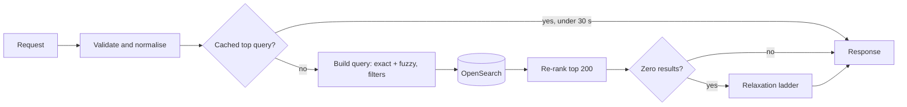

| Status | Stable |
| -- | -- |
| Version | 2.3 |
| Updated | 2026-03-16 |
| Owner | DemoOscar |
| Applies to | `search-svc`, called by the web shop, the app and the public API's product search ([SPEC-036](@SPEC-036)) |

## Overview

One internal endpoint answers every product search: free text, category browsing, filters and sorting. It returns results, facet counts and, when the query had to be relaxed, what was dropped. Clients never talk to OpenSearch directly.

`GET /v2/search` on `search-svc`, internal gRPC `SearchService.Search` with the same fields.

## Request

| Parameter | Type | Required | Default | Description |
| -- | -- | -- | -- | -- |
| `q` | string, at most 200 characters | no | | Free text; empty for pure category browsing |
| `category` | string | no | | Category id, for example `c-1042`; restricts results to it and its children |
| `filter` | repeated `name:value` | no | | Facet selections, for example `colour:green`; values of one facet are OR, facets are AND |
| `price_min`, `price_max` | integer, minor units | no | | Price range in the buyer's currency |
| `sort` | enum | no | `relevance` | `relevance`, `price_asc`, `price_desc`, `newest`, `rating` |
| `page_size` | integer 1 to 60 | no | 24 | Results per page |
| `cursor` | string | no | | From the previous response; opaque |
| `lang` | string | no | from the request | Interface language, a prior for query language detection |
| `country` | string | yes | | Buyer's delivery country; filters listings that do not ship there |

## Response

```json
{
  "query_id": "01JD8ZQ7F3K1N2C4V6B8M0X9A2",
  "total": 1284,
  "results": [
    {
      "listing_id": "L-55120",
      "title": "Oak standing desk, 140 cm",
      "price": { "amount_minor": 34900, "currency": "EUR" },
      "rating": 4.6,
      "image": "https://img.example.com/l/55120/main.webp",
      "badges": ["fast_delivery"]
    }
  ],
  "facets": [
    { "name": "colour", "values": [{ "value": "natural", "count": 412 }, { "value": "black", "count": 233 }] }
  ],
  "relaxation": null,
  "next_cursor": "eyJzIjpbMC44MTIsIkwtNTUxMjAiXX0"
}
```

`query_id` is logged with every analytics event of the result page ([SPEC-065](@SPEC-065)) so clicks and orders can be joined to the search that caused them. `relaxation` is set when [RFC-062](@RFC-062) recovered a zero-result query.

## Behaviour



## Limits and budgets

| Item | Limit |
| -- | -- |
| p99 latency, server side | 200 ms |
| Query length | 200 characters; longer queries are cut at a word boundary |
| Filters per request | 30 |
| Deepest result reachable | 1,000 (cursor pages beyond return an empty page) |
| Requests per client service | 3,000 per second, enforced by the mesh |

## Errors

| Code | When |
| -- | -- |
| `INVALID_ARGUMENT` | Unknown sort, malformed filter, page size out of range |
| `NOT_FOUND` | Unknown category id |
| `DEADLINE_EXCEEDED` | OpenSearch did not answer in 2 seconds; partial results are never returned to clients |

## Version history

| Version | Date | Change |
| -- | -- | -- |
| 2.0 | 2025-06-02 | First version on OpenSearch ([ADR-012](@ADR-012)) |
| 2.1 | 2025-09-29 | Typo tolerance ([RFC-055](@RFC-055)) |
| 2.2 | 2026-01-12 | Learned re-ranking ([RFC-057](@RFC-057)), `query_id` |
| 2.3 | 2026-03-16 | `relaxation` ([RFC-062](@RFC-062)) |
