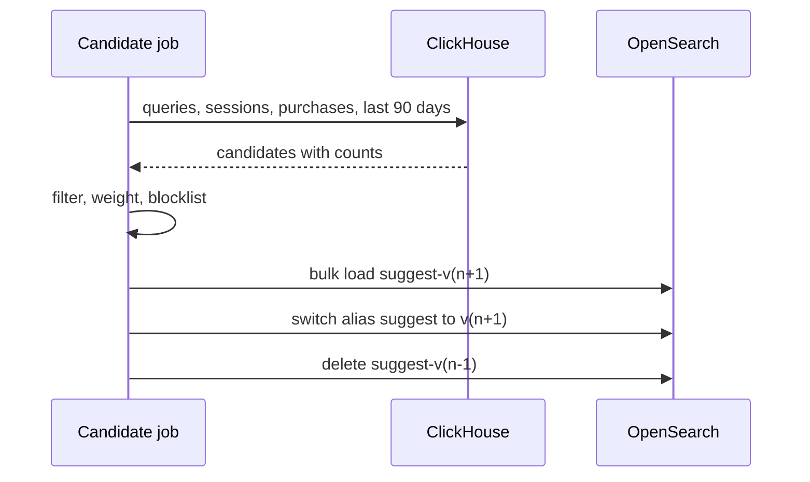

| Status | Stable |
| -- | -- |
| Version | 1.2 |
| Updated | 2026-02-16 |
| Owner | DemoOscar |
| Applies to | The OpenSearch index `suggest-v*` and `GET /v2/suggest` on `search-svc` ([RFC-060](@RFC-060)) |

## Overview

Suggestions under the search box come from a separate, small index rebuilt every 15 minutes. It holds three kinds of entries: past queries, categories and brands. Each entry has a weight that orders suggestions for the same prefix.

## Entry

| Field | Type | Description |
| -- | -- | -- |
| `text` | string | What the buyer sees and what is searched when chosen |
| `kind` | enum | `query`, `category`, `brand` |
| `weight` | integer | Ordering within a prefix; see below |
| `top_category` | keyword, context | Lets the app prefer the category the buyer is browsing |
| `target` | string | For categories and brands: the page to open, for example `c-1042` |
| `lang` | keyword | Language of the text |

## Weight

```python
def weight(purchases_90d: int, sessions_90d: int, kind: str) -> int:
    """Purchases dominate; sessions break ties; categories get a floor so new ones appear."""
    base = purchases_90d * 100 + sessions_90d
    floor = {"category": 5_000, "brand": 1_000, "query": 0}[kind]
    return max(base, floor)
```

## Inclusion rules

* Queries searched by at least 3 distinct sessions in 90 days, with at least one result, and fewer than 9 words.
* Not on the blocklist (offensive, unsafe or trademark-misleading terms), reviewed weekly.
* At most 8 million entries; when over, the lowest weights are dropped ([RN-056](@RN-056)).

## Mapping excerpt

```json
{
  "mappings": {
    "properties": {
      "suggest": {
        "type": "completion",
        "analyzer": "simple",
        "preserve_separators": true,
        "max_input_length": 60,
        "contexts": [{ "name": "top_category", "type": "category", "path": "top_category" }]
      },
      "kind": { "type": "keyword" },
      "target": { "type": "keyword" },
      "lang": { "type": "keyword" }
    }
  }
}
```

## API

`GET /v2/suggest?prefix=stan&category=c-1000&size=8`

```json
{
  "suggestions": [
    { "text": "standing desk", "kind": "query" },
    { "text": "Standing desks", "kind": "category", "target": "c-1088" },
    { "text": "standing desk converter", "kind": "query" },
    { "text": "stand mixer", "kind": "query" }
  ]
}
```

## Rebuild



## Limits

| Item | Limit |
| -- | -- |
| p99 latency, server side | 30 ms |
| Prefix length | 2 to 60 characters |
| Suggestions per request | 1 to 10 |
| Rebuild time | under 6 minutes for 2.6 million entries |

## Version history

| Version | Date | Change |
| -- | -- | -- |
| 1.0 | 2025-10-13 | Nightly rebuild, queries and categories |
| 1.1 | 2025-11-24 | Brands; fuzzy prefix of 1 edit from 4 characters |
| 1.2 | 2026-02-16 | Rebuild every 15 minutes; `lang` field |
