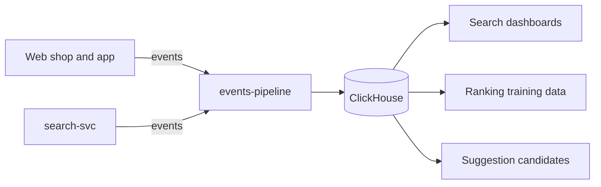

| Status | Stable |
| -- | -- |
| Version | 1.4 |
| Updated | 2026-03-16 |
| Owner | DemoJudy |
| Applies to | Events the web shop, the app and `search-svc` send about searches; stored per [SPEC-020](@SPEC-020) |

## Overview

Every search, suggestion, click and result-page interaction produces an analytics event that carries the `query_id` of the search ([SPEC-059](@SPEC-059)). Joined with order events ([SPEC-017](@SPEC-017)), they give click-through, purchases per search, zero-result rate and the labels for learning to rank ([SPEC-061](@SPEC-061)).

## Events

| Event | Sent by | When | Key fields |
| -- | -- | -- | -- |
| `search_performed` | search-svc | Every search answered | `query_id`, `q`, `category`, `filters`, `total`, `query_class`, `latency_ms` |
| `search_zero_result` | search-svc | Original query had no hits | `query_id`, `q`, `predicted_category` |
| `zero_result_recovered` | search-svc | Relaxation found results ([RFC-062](@RFC-062)) | `query_id`, `step`, `total` |
| `search_result_viewed` | client | Results scrolled into view | `query_id`, `positions` |
| `search_result_clicked` | client | Result opened | `query_id`, `listing_id`, `position`, `sponsored` |
| `facet_applied` | client | A facet value chosen | `query_id`, `facet`, `value` |
| `suggestion_chosen` | client | Suggestion tapped ([SPEC-064](@SPEC-064)) | `prefix`, `text`, `kind`, `rank` |
| `search_refined` | client | New search within 60 s of the previous one | `query_id`, `previous_query_id` |

## Example

```json
{
  "event": "search_result_clicked",
  "time": "2026-03-18T10:42:07.512Z",
  "session": "s-7f3c91a0",
  "platform": "app_android",
  "app_version": "6.4.0",
  "properties": {
    "query_id": "01JD8ZQ7F3K1N2C4V6B8M0X9A2",
    "listing_id": "L-55120",
    "position": 3,
    "sponsored": false
  }
}
```

The session id is random per session and is not linked to an account in these events. Search text is stored as typed, after removing anything that looks like an email address or a phone number.

## Derived measures

| Measure | Definition |
| -- | -- |
| Click-through | Searches with at least one `search_result_clicked` within 60 s, over all searches |
| Zero-result rate | `search_zero_result` over `search_performed`, counting recovered searches as zero results |
| Purchases per 1,000 searches | Orders whose last search in the session was this one, per 1,000 searches |
| Mean reciprocal rank | Mean of 1 / position of the first click, 0 when none |

## Flow



## Retention

Raw events are kept 13 months ([ADR-027](@ADR-027)); feature logs for training 180 days.

## Version history

| Version | Date | Change |
| -- | -- | -- |
| 1.0 | 2025-06-02 | `search_performed`, `search_result_clicked` |
| 1.1 | 2025-10-13 | `suggestion_chosen` |
| 1.2 | 2025-10-20 | `facet_applied` |
| 1.3 | 2026-01-12 | `query_class`, `search_refined` |
| 1.4 | 2026-03-16 | `zero_result_recovered`, `sponsored` flag |
