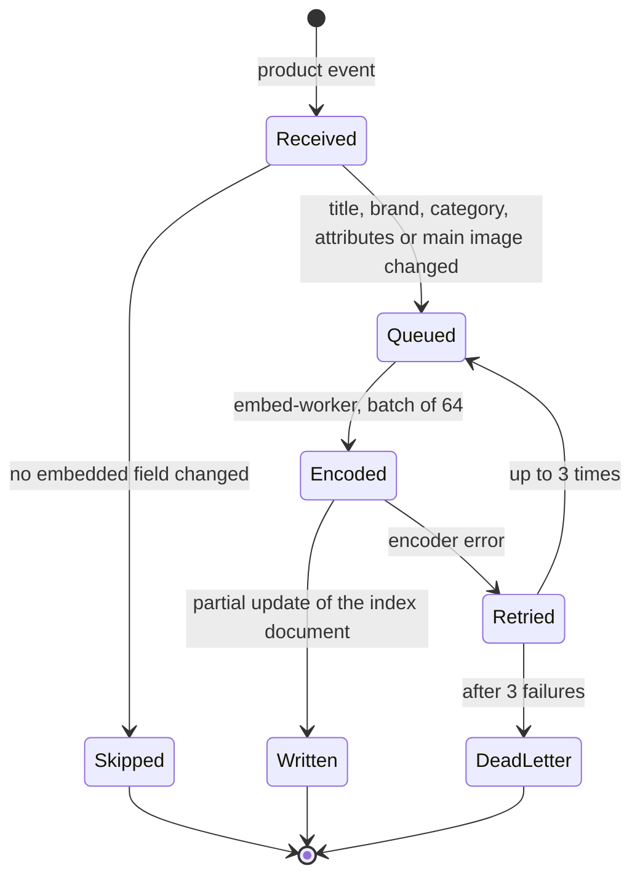

| Status | Stable |
| -- | -- |
| Version | 1.1 |
| Updated | 2026-09-14 |
| Owner | DemoHeidi |
| Applies to | `embed-worker` and the `embedding` field of the product index ([RFC-059](@RFC-059), [ADR-045](@ADR-045)) |

## Overview

Every listing gets a 512-dimension vector from an open image and text model of the CLIP family, chosen in [RN-057](@RN-057). The pipeline recomputes a vector only when something that goes into it changes, and writes it into the product index ([SPEC-060](@SPEC-060)).

## Inputs

| Input | Used for | Source |
| -- | -- | -- |
| Title | text tower | product events ([SPEC-018](@SPEC-018)) |
| Brand, category path | text tower | product events |
| Top five attributes by fill rate in the category | text tower | product events |
| Main image, resized to 224 × 224, centre crop | image tower | image CDN ([ADR-041](@ADR-041)) |

The text input is assembled in a fixed order and cut at 77 tokens:

```text
{title}. Brand: {brand}. Category: {category_path}. {attr1}: {value1}; {attr2}: {value2}; ...
```

## Vector

* Image and text vectors are each L2-normalised, then averaged with weights 0.6 (image) and 0.4 (text), then normalised again.
* Listings without an image use the text vector alone; the field `embedding_source` records `image_text` or `text`.
* Model version is stored in `embedding_model`; queries only compare vectors of the same model version.

## Triggers



A hash of the embedded inputs is kept per listing; an event whose hash is unchanged is skipped. 71 % of product events are price or stock changes and are skipped this way.

## Worker

```yaml
embed-worker:
  replicas: 4
  resources: { cpu: "8", memory: 12Gi }
  batch_size: 64
  max_wait_ms: 500
  model: clip-family-b32-v2
  consumer_group: embed-worker
  dead_letter_topic: products.embed.dlq
```

Failed messages go to the dead letter topic in the format of [SPEC-028](@SPEC-028).

## Full re-encode

A model change re-encodes the whole catalogue into a new field (`embedding_v2`), then switches queries over in one deploy. With 4 workers the 3.1 million listings take about 9 hours.

## Service levels

| Measure | Target | September 2026 |
| -- | -- | -- |
| Listing change to new vector searchable, p95 | 5 minutes | 1 min 40 s |
| Listings without a vector | under 0.5 % | 0.12 % |
| Encoder errors | under 0.1 % of batches | 0.03 % |

## Version history

| Version | Date | Change |
| -- | -- | -- |
| 1.0 | 2026-07-06 | First version, text and image |
| 1.1 | 2026-09-14 | Input hash to skip unchanged listings; dead letter topic |
