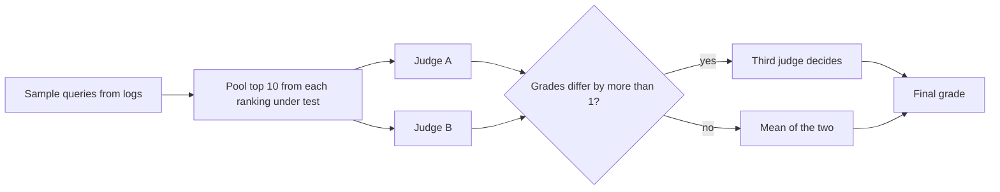

| Status | Stable |
| -- | -- |
| Version | 2.1 |
| Updated | 2026-05-11 |
| Owner | DemoNina |
| Applies to | Every human relevance judgement for search and similar products: the frozen baseline set, experiment sets, language sets |

## Overview

Human judgements are the ground truth for search quality. Click data says what buyers did; judgements say whether a result answers the query. The frozen baseline set of 1,800 queries from [RN-051](@RN-051) is graded with these guidelines, and every ranking change reports NDCG@10 against it ([SPEC-061](@SPEC-061)).

## Grades

| Grade | Name | Meaning | Example for "oak standing desk" |
| -- | -- | -- | -- |
| 3 | Exact | Matches every stated attribute | An oak-top standing desk |
| 2 | Close | Right product type, one attribute differs | A walnut standing desk |
| 1 | Related | Useful to someone with this need, not what was asked | A standing desk converter |
| 0 | Wrong | Does not help | An oak dining table |

Rules for grading:

1. Judge the listing as shown on the results page and its product page: title, images, attributes. Do not judge price or seller unless the query asks for it ("cheap", "under 50").
2. A listing that is out of stock is graded as if it were in stock; stock is a ranking signal, not relevance.
3. For vague queries ("gift for dad"), grade 2 for any reasonable answer; reserve 3 for queries with a clear target.
4. When unsure between two grades, choose the lower one and add a note.

## Similarity variant

For similar products ([RFC-059](@RFC-059)) judges see a seed product and a candidate and answer one question: would a buyer who wanted the seed accept the candidate instead? Yes or no; precision@10 is the share of yes.

## Process

* Every query is graded by two judges, independently. Agreement is reported as weighted kappa; a set below 0.6 is re-trained and re-graded.
* Pooling: results from every ranking under test are graded, so no ranking is judged on results only it returns.
* Judges see results in random order without the ranking that produced them.

## Sets

| Set | Queries | Use | Last graded |
| -- | -- | -- | -- |
| Frozen baseline | 1,800 | Every ranking change | 2025-06 |
| Language, five sets | 200 each | [RN-060](@RN-060), [RFC-063](@RFC-063) | 2026-06 |
| Similar products | 2,400 seeds | [RN-057](@RN-057) | 2026-05 |

The baseline set is re-pooled, not re-sampled, when new rankings bring unjudged results into the top 10: new results are graded and old grades stay.

## Version history

| Version | Date | Change |
| -- | -- | -- |
| 1.0 | 2025-06-02 | Four grades, two judges |
| 2.0 | 2025-10-06 | Pooling across rankings; out-of-stock rule |
| 2.1 | 2026-05-11 | Similarity variant |
