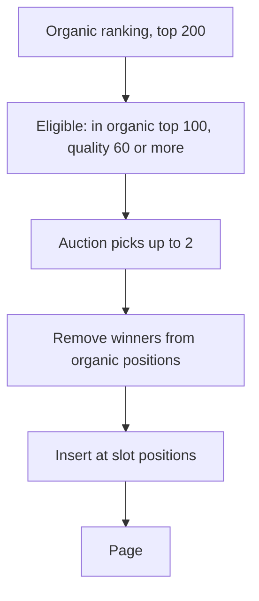

| Status | Draft |
| -- | -- |
| Version | 0.3 |
| Updated | 2026-10-05 |
| Owner | DemoJudy |
| Applies to | Search results pages, web shop and app, if [RFC-064](@RFC-064) is accepted |

## Overview

Where sponsored listings may appear in search results, how they are labelled, and which listings are eligible. The organic ranking is computed first and is not changed by sponsored slots, except that a listing shown in a sponsored slot is removed from the organic positions on the same page.

## Slots

| Surface | Results per page | Sponsored positions | Maximum per page |
| -- | -- | -- | -- |
| Web shop, search | 24 | 3, 9 | 2 |
| Web shop, category page | 24 | 5 | 1 |
| App, search | 20 | 2, 8 | 2 |
| App, category page | 20 | 4 | 1 |
| Similar products row | 12 | none | 0 |

No sponsored slot appears when the organic results have fewer than 8 listings, or on a page reached through relaxation ([RFC-062](@RFC-062)).

## Eligibility

A listing may fill a slot only if all hold:

* It ranks in the organic top 100 for the same query and filters.
* It is in stock and ships to the buyer's country.
* Its listing quality score is at least 60 ([SPEC-085](@SPEC-085)).
* Its seller is in good standing ([SPEC-082](@SPEC-082)).

## Response fields

Sponsored results use the same result object as organic ones in [SPEC-059](@SPEC-059), with three more fields:

```json
{
  "listing_id": "L-90231",
  "title": "Bamboo laptop stand, adjustable",
  "price": { "amount_minor": 3990, "currency": "EUR" },
  "sponsored": true,
  "sponsor_label": "Sponsored",
  "auction_id": "auc-01JF2C5Y7Q8W"
}
```

Clicks on sponsored results are logged with `sponsored: true` ([SPEC-065](@SPEC-065)) and billed through `auction_id`.

## Labelling

* The label "Sponsored" is shown above the title in the same size as the title, never only as an icon.
* Tapping the label explains why the listing is shown and links to the buyer's ad settings.
* Sponsored results never carry badges that organic results earn ("Best seller", "Top rated").

## Page assembly



## Open items

| Item | Status |
| -- | -- |
| Label wording per country | Waiting for legal review |
| Frequency cap per buyer session | Proposed: same listing at most 3 times per session |
| Reporting to sellers | In [RFC-076](@RFC-076) |

## Version history

| Version | Date | Change |
| -- | -- | -- |
| 0.1 | 2026-09-07 | Slots and eligibility |
| 0.2 | 2026-09-21 | No slots on relaxed pages; category pages |
| 0.3 | 2026-10-05 | Labelling rules |
