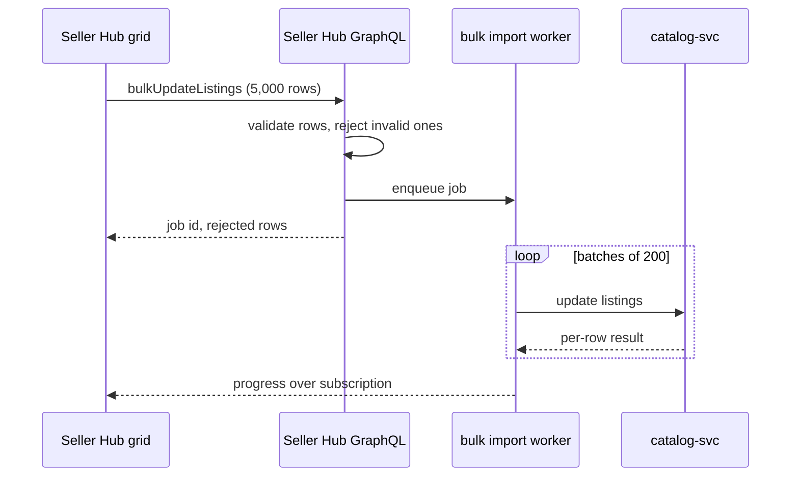

| Status | Implemented |
| -- | -- |
| Created | 2026-05-12 |
| Authors | DemoNina |
| Reviewers | DemoLaura, DemoKen |
| Target | Q3 2026 |
| Decision | [ADR-043 Use schema-first GraphQL for Seller Hub](@ADR-043) |

## Summary

Give sellers a grid in Seller Hub where they can change price, stock, title and status for up to 5,000 listings at once, and apply the change as one background job with a per-row result.

## Motivation

Sellers with large catalogs edit listings one page at a time. In March 2026, sellers with more than 1,000 listings made 61 % of all listing edits, and a median price change across a category took them 47 minutes. 22 % of them used the CSV upload instead, which needs a spreadsheet round trip and fails as a whole when one row is wrong. Support handled 380 tickets a month about "my CSV upload did nothing".

## Proposal

### The grid

* Filters choose the listings: category, status, stock below a threshold, or a saved search. At most 5,000 rows per edit.
* Columns: title, SKU, price, sale price, stock, status. Cells validate as the seller types, with the rules of [SPEC-079](@SPEC-079).
* Bulk actions on a column: set to a value, add or subtract an amount, change by a percentage, round to .99.
* A preview shows every changed row before anything is saved.

### The job

The grid sends one mutation; the server runs it as a job built on the [bulk catalog import](@SPEC-041) pipeline, so partners and Seller Hub share one code path.

```graphql
mutation BulkUpdate($input: BulkUpdateListingsInput!) {
  bulkUpdateListings(input: $input) {
    job { id status total }
    rejected { listingId field code }
  }
}
```

```json
{
  "input": {
    "idempotencyKey": "4f0c2a8e-7b1d-4e55-9d2f-0c6c1b2e9a11",
    "changes": [
      { "listingId": "lst_5821", "price": { "amount": 2499, "currency": "EUR" } },
      { "listingId": "lst_5822", "stock": 0, "status": "PAUSED" }
    ]
  }
}
```

Prices are integer minor units ([ADR-020](@ADR-020)). The idempotency key follows [SPEC-035](@SPEC-035), so a double click applies the change once.



Valid rows are applied even when others are rejected; the seller sees the rejected rows with the reason and can fix them in place.

## Alternatives

| Option | Effort | Partial success | Why not |
| -- | -- | -- | -- |
| Improve the CSV upload only | small | possible | Still a spreadsheet round trip |
| Inline editing on the listings page, row by row | small | yes | Does not solve "change 800 prices by 10 %" |
| **Grid with a background job** | **medium** | **yes** | Chosen |
| A desktop app for sellers | large | yes | A second product to maintain |

## Rollout

- [X] Grid behind the `seller_bulk_editor` flag ([ADR-022](@ADR-022))
- [X] 40 sellers with large catalogs in a closed beta, May to June 2026
- [X] Open to all sellers, 2026-07-21
- [X] Measure use and edit times ([RN-074](@RN-074))
- [ ] Remove the "advanced CSV" help pages once CSV uploads fall below 5 % of edits

## Open questions

* Should the grid allow undo of a whole job? A job keeps the previous values for 7 days, so it is possible; we wait for the beta feedback.
