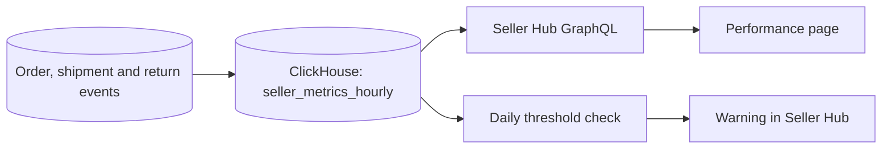

| Status | Accepted |
| -- | -- |
| Created | 2026-03-17 |
| Authors | DemoLaura |
| Reviewers | DemoNina, DemoGrace |
| Target | Q4 2026 |
| Metrics | [SPEC-082 Seller performance metrics](@SPEC-082) |

## Summary

Add a Performance page to Seller Hub that shows each seller the six numbers DemoMart judges them by, how they compare with sellers in the same category, and what to do about a number that is slipping.

## Motivation

DemoMart already measures late shipments, cancellations and return rates, and restricts sellers whose numbers stay below the bar. Sellers only learn this from a warning message. In 2025, 310 sellers were restricted; 74 % of them said in the follow-up survey that they had not known their numbers were close to the limit. Restrictions cost both sides: a restricted seller's listings drop out of search for at least 14 days.

## Proposal

### What the page shows

* Six metrics from [SPEC-082](@SPEC-082): late shipment rate, cancellation rate, return rate, valid tracking rate, response time to buyer questions, and listing quality ([SPEC-085](@SPEC-085)).
* For each: the seller's value over the last 30 days, a 13-week trend, the category median, and the threshold that leads to a warning.
* A status per metric: Good, Watch (within 20 % of the threshold) or At risk.
* For a metric at Watch or worse, the three orders or listings that hurt it most, with a link to each.

### Where the numbers come from

Metrics are computed every hour in ClickHouse from order, shipment and return events ([ADR-011](@ADR-011)), and served to Seller Hub through GraphQL ([ADR-043](@ADR-043)).



```graphql
type SellerMetric {
  name: MetricName!
  value: Float!
  categoryMedian: Float!
  threshold: Float!
  status: MetricStatus!
  weekly: [Float!]!
}
```

### What we leave out

No ranking against named sellers, and no metric that the seller cannot change by their own actions.

## Alternatives

| Option | Effort | Why not |
| -- | -- | -- |
| A monthly email with the numbers | small | Too late to act on; email open rate is 31 % |
| Show metrics only when a warning is sent | small | Same surprise, a few days earlier |
| **A live page with thresholds and causes** | **medium** | Chosen |

## Rollout

- [X] Metric definitions agreed ([SPEC-082](@SPEC-082))
- [ ] Hourly metrics table in ClickHouse
- [ ] Page behind the `seller_performance_page` flag for 5 % of sellers
- [ ] Compare restriction rates between sellers with and without the page for 8 weeks
- [ ] Open to all sellers

## Open questions

* Should Watch status also send a notification? We start with the page alone and measure first.
* Which category median do we show a seller who sells in four categories? Proposal: the category with most of their orders.
