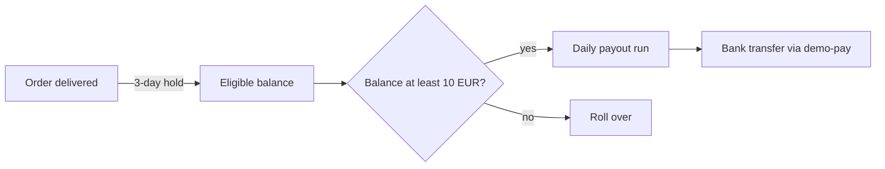

| Status | Rejected |
| -- | -- |
| Created | 2026-03-24 |
| Authors | DemoPeggy |
| Reviewers | DemoFrank, DemoNina, DemoHeidi |
| Target | Q3 2026 |
| Outcome | Twice-weekly payouts in [SPEC-081 Payout schedule](@SPEC-081) version 2.0 |

> [!IMPORTANT]
> Rejected on 2026-04-09. Daily payouts would have nearly quadrupled payout fees and left too small a reserve for refunds. The review chose twice-weekly payouts instead; see **Decision** at the end.

## Summary

Pay sellers every business day instead of every Monday, for orders that were delivered at least 3 days earlier.

## Motivation

Sellers wait up to 9 days for their money: an order delivered on a Saturday becomes payable on Tuesday, after the 3-day hold, and then waits for the next Monday's payout run. In the payout survey ([RN-073](@RN-073)), 34 % of sellers asked for daily payouts, and small sellers rated payouts lowest. Several sellers of handmade goods told us they buy materials for the next order with the money from the last one.

## Proposal

* Run the payout job every business day at 06:00 UTC instead of every Monday.
* Pay every order line delivered at least 3 days earlier and not under dispute ([SPEC-057](@SPEC-057)).
* Keep the minimum payout of 10 EUR; smaller balances roll over.
* Transfers go through the payment orchestrator ([ADR-038](@ADR-038)), as today.

## Cost and risk

| Item | Weekly payouts (today) | Daily payouts (proposed) |
| -- | -- | -- |
| Transfers per month | 41,000 | 152,000 |
| Transfer fees per month | 10,250 EUR | 38,000 EUR |
| Average balance held for refunds | 6.8 days of sales | 2.1 days of sales |
| Refunds that would exceed the held balance | 0.4 % of refunds | 3.1 % of refunds (estimate) |
| Engineering effort | none | 3 weeks |

When a refund exceeds the seller's held balance, DemoMart pays the buyer first and recovers the money from the seller later. At 3.1 %, that is about 1,900 recoveries a month, each a manual case.

## Alternatives

| Option | Wait for a seller (worst case) | Fees per month | Refund cover |
| -- | -- | -- | -- |
| Weekly (today) | 9 days | 10,250 EUR | good |
| Daily (this RFC) | 5 days | 38,000 EUR | weak |
| **Twice weekly, Tuesday and Friday** | **6 days** | **19,600 EUR** | **good** |
| On-demand payout for a fee paid by the seller | 3 days | paid by sellers | good |

## Rollout

- [X] Cost model reviewed with the finance and payments teams
- [X] Review meeting, 2026-04-09: rejected
- [X] Twice-weekly schedule specified in [SPEC-081](@SPEC-081) version 2.0
- [ ] On-demand payouts reconsidered after six months of the new schedule

## Open questions

* Would small sellers accept a fee for on-demand payouts? Not answered; the survey did not ask.

## Decision

Rejected. The fees and the weaker refund cover outweigh the gain for most sellers. Twice-weekly payouts cut the worst-case wait from 9 to 6 days for 9,350 EUR a month more than today, with the refund cover almost unchanged.
