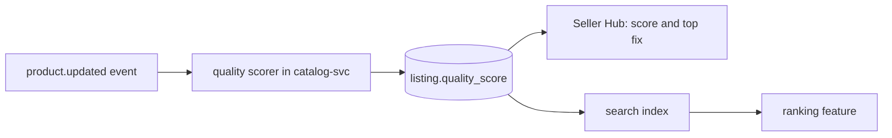

| Status | Accepted |
| -- | -- |
| Created | 2026-05-05 |
| Authors | DemoNina |
| Reviewers | DemoOscar, DemoLaura |
| Target | Q4 2026 |
| Evidence | [RN-071 Listing quality and conversion](@RN-071) |

## Summary

Give every listing a quality score from 0 to 100, computed from what makes buyers order (photos, attributes, description, price competitiveness), show it to the seller with the one change that would raise it most, and use it as a ranking feature in search.

## Motivation

Listings with a score above 80 in our offline model convert six times as well as listings below 20: 3.6 % against 0.6 % of views ([RN-071](@RN-071)). 38 % of active listings have one photo, and 27 % have none of the attributes buyers filter on. Sellers do not know which listings need work; the listings page shows no signal at all.

## Proposal

### The score

Five components with fixed weights, specified in [SPEC-085](@SPEC-085):

| Component | Weight | Full marks when |
| -- | -- | -- |
| Photos | 30 | 5 or more photos, at least 1,000 px on the short side |
| Attributes | 25 | All category attributes filled ([SPEC-079](@SPEC-079)) |
| Title and description | 20 | Title 30 to 120 characters; description of 300 characters or more |
| Price | 15 | Within 10 % of the category median for the same product type |
| Shipping | 10 | Delivery estimate of 3 days or less, with tracking |

The score is computed when a listing changes, from [product events](@SPEC-018), and stored on the listing.

### In Seller Hub

Each listing shows its score and the single fix with the most points, for example "Add 3 more photos: +18". The listings page can be sorted by score, and the [bulk editor](@RFC-074) can filter on it.

### In search

The score becomes one feature among the [ranking features](@SPEC-061), with a weight learned by the ranking model ([RFC-057](@RFC-057)), not a fixed boost.

## Alternatives

| Option | Effort | Why not |
| -- | -- | -- |
| A checklist per listing, no score | small | No way to sort or rank by it |
| A score learned end to end from conversions | large | Sellers cannot see why their score is low |
| **A rule-based score with fixed weights** | **medium** | Chosen; explainable, can be learned later |

## Rollout

- [X] Weights fitted on 6 months of views and orders ([RN-071](@RN-071))
- [ ] Score in Seller Hub for all sellers
- [ ] Score as a ranking feature, offline evaluation first ([RN-053](@RN-053))
- [ ] Review the weights after one quarter

## Open questions

* Should the score count in the [seller performance metrics](@SPEC-082)? It does, as the average over active listings.
