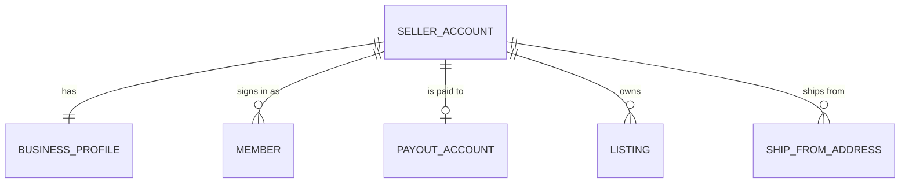
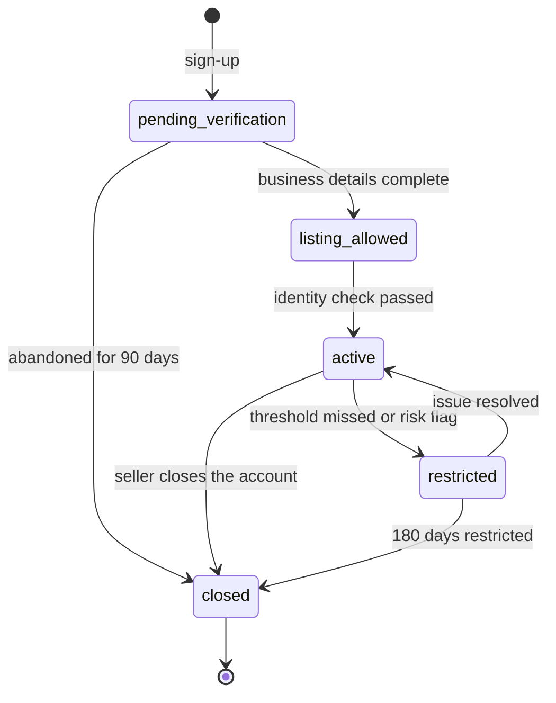

| Status | Stable |
| -- | -- |
| Version | 2.1 |
| Updated | 2026-06-02 |
| Owner | DemoNina |
| Applies to | `identity-svc`, Seller Hub, the public API's seller resources |

## Overview

A seller account is the business that sells on DemoMart. It owns listings, receives orders and payouts, and has one or more members who sign in to Seller Hub. A person is never the account: members come and go, the account stays. Roles of members are in [SPEC-086](@SPEC-086).



## Seller account

| Field | Type | Required | Description |
| -- | -- | -- | -- |
| `id` | string | yes | `sel_` followed by 10 characters; never reused |
| `display_name` | string, 2 to 60 characters | yes | Shown to buyers on listings and orders |
| `state` | enum | yes | See **States** |
| `country` | ISO 3166-1 alpha-2 | yes | The country of registration; decides tax and payout rules |
| `currency` | ISO 4217 | yes | Payout currency; fixed after the first payout |
| `created_at` | timestamp (UTC) | yes | |
| `verified_at` | timestamp (UTC) | no | When the identity check passed |
| `restricted_reason` | enum | no | Set only in `restricted`: `performance`, `verification`, `payment_risk` |

## Business profile

| Field | Type | Required | Description |
| -- | -- | -- | -- |
| `legal_form` | enum | yes | `individual`, `sole_trader`, `company` |
| `registration_number` | string | for companies | Validated per country format |
| `vat_number` | string | no | Checked against the tax authority's service where one exists |
| `support_contact` | reference | yes | A contact form in Seller Hub; no personal contact data is shown to buyers |

Personal data in the profile, such as the legal representative's name, is encrypted at the field level ([ADR-028](@ADR-028)) and never leaves `identity-svc`.

## Example

```json
{
  "id": "sel_8k2m4q9x1z",
  "display_name": "Demo seller 1042",
  "state": "active",
  "country": "DE",
  "currency": "EUR",
  "created_at": "2025-09-14T08:12:44Z",
  "verified_at": "2025-09-14T09:03:10Z",
  "business_profile": { "legal_form": "sole_trader", "vat_number": "DE000000000" },
  "payout_account": { "id": "pay_3j7c", "schedule": "twice_weekly" }
}
```

## States



| State | Can create drafts | Listings visible | Receives payouts |
| -- | -- | -- | -- |
| `pending_verification` | no | no | no |
| `listing_allowed` | yes | no | no |
| `active` | yes | yes | yes |
| `restricted` | yes | no | yes, after a 30-day hold |
| `closed` | no | no | final payout only |

`listing_allowed` was added in version 2.1 for [RFC-079](@RFC-079).

## Version history

| Version | Date | Change |
| -- | -- | -- |
| 1.0 | 2025-03-03 | First version |
| 2.0 | 2025-10-20 | Members split from the account; one account, many members |
| 2.1 | 2026-06-02 | `listing_allowed` state |

## Related

* [SPEC-081 Payout schedule](@SPEC-081)
* [SPEC-082 Seller performance metrics](@SPEC-082), which can move an account to `restricted`
