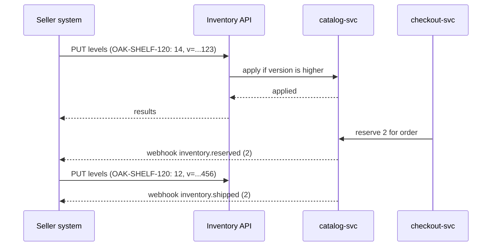

| Status | Stable |
| -- | -- |
| Version | 1.2 |
| Updated | 2026-05-18 |
| Owner | DemoKen |
| Applies to | Seller systems that push stock levels, `catalog-svc`, the [inventory endpoints](@SPEC-038) |

## Overview

Seller systems keep DemoMart's stock levels current by pushing absolute levels with a version per SKU. DemoMart sends reservations back as webhooks. The design and its reasons are in [RFC-075](@RFC-075).

## Push

`PUT /v2/inventory/levels` with up to 1,000 updates:

| Field | Type | Required | Rule |
| -- | -- | -- | -- |
| `sku` | string | yes | A SKU of the seller ([SPEC-079](@SPEC-079)) |
| `available` | integer | yes | 0 to 999,999; the quantity the seller can ship now |
| `version` | integer (int64) | yes | Increases per SKU; milliseconds since epoch is a good choice |
| `warehouse` | string | no | For sellers with several ship-from addresses; default is the main one |

Headers: `Idempotency-Key` ([SPEC-035](@SPEC-035)) is required.

## Result per SKU

```json
{
  "results": [
    { "sku": "OAK-SHELF-120", "status": "applied", "available": 14, "reserved": 2, "version": 1767225600123 },
    { "sku": "OAK-SHELF-90", "status": "stale", "current_version": 1767225700000 },
    { "sku": "PINE-BOX-S", "status": "unknown_sku" }
  ]
}
```

| Status | Meaning | What the seller system does |
| -- | -- | -- |
| `applied` | The level is stored | Nothing |
| `stale` | DemoMart already has a higher version | Nothing; a newer level won |
| `unknown_sku` | No listing with this SKU | Create the listing or remove the SKU from the feed |
| `invalid` | `available` out of range | Fix the value |

## Reservations

Buyers' orders reserve stock ([SPEC-054](@SPEC-054)). DemoMart subtracts reservations from the pushed level when it shows availability to buyers: `sellable = available - reserved`. The seller system learns about reservations from webhooks ([SPEC-040](@SPEC-040)):

| Webhook | When |
| -- | -- |
| `inventory.reserved` | A buyer paid; the items are held |
| `inventory.released` | The reservation ended without shipping: cancelled or expired |
| `inventory.shipped` | The items left; the seller system should lower its own stock if it has not |



## Limits

| Limit | Value |
| -- | -- |
| Updates per request | 1,000 |
| Requests per second per seller | 20 ([SPEC-034](@SPEC-034)) |
| Webhook retries | 8 attempts over 24 hours ([SPEC-039](@SPEC-039)) |
| Version range | positive int64 |

## Version history

| Version | Date | Change |
| -- | -- | -- |
| 1.0 | 2026-01-12 | First version |
| 1.1 | 2026-02-23 | `inventory.shipped` webhook |
| 1.2 | 2026-05-18 | `warehouse` field for several ship-from addresses |
