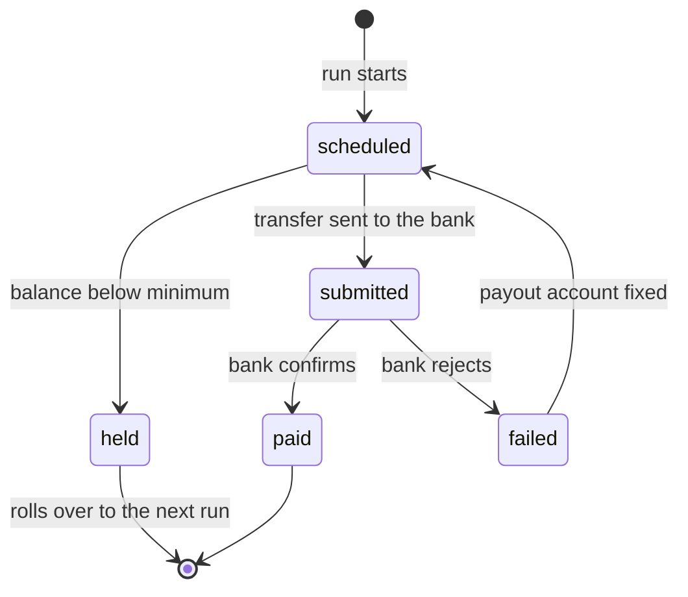

| Status | Stable |
| -- | -- |
| Version | 2.0 |
| Updated | 2026-04-14 |
| Owner | DemoPeggy |
| Applies to | `demo-pay`, Seller Hub payouts page, payout statements |

## Overview

DemoMart pays sellers twice a week, on Tuesday and Friday, for order lines that were delivered at least 3 days earlier. Version 2.0 replaced the weekly Monday run after [RFC-077](@RFC-077) was rejected in favour of this schedule. Money moves through the payment orchestrator ([ADR-038](@ADR-038)); how a single order line becomes payable is in [SPEC-057](@SPEC-057).

## Schedule

| Item | Rule |
| -- | -- |
| Payout runs | Tuesday and Friday, 06:00 UTC; a bank holiday in the seller's country moves the run to the next business day |
| Eligible lines | Delivered at least 3 days before the run, not under a return or dispute |
| Minimum payout | 10 EUR, or the equivalent in the payout currency; smaller balances roll over |
| Reserve | 5 % of the last 30 days' sales for sellers active less than 90 days; none after |
| Deductions | Refunds, shipping labels ([RFC-078](@RFC-078)), fees, in that order |
| Currency | The seller account's currency ([SPEC-078](@SPEC-078)); conversion per [SPEC-058](@SPEC-058) |

All amounts are integer minor units with a currency code ([ADR-020](@ADR-020)).

## Payout states



A payout that fails twice moves the seller account's payout account to `needs_attention`, and Seller Hub asks the seller to check their bank details.

## Statement

Every payout has a statement, one line per order line and deduction:

```json
{
  "payout_id": "po_2026_04_17_91c2",
  "seller_id": "sel_8k2m4q9x1z",
  "run": "2026-04-17",
  "currency": "EUR",
  "lines": [
    { "type": "sale", "order_line_id": "ol_55120", "amount": 4900 },
    { "type": "commission", "order_line_id": "ol_55120", "amount": -588 },
    { "type": "shipping_label", "label_id": "lbl_7731", "amount": -495 },
    { "type": "refund", "order_line_id": "ol_54007", "amount": -1999 }
  ],
  "total": 1818,
  "state": "paid"
}
```

## Timing in practice

| Delivered on | Paid on (version 1, weekly) | Paid on (version 2) |
| -- | -- | -- |
| Monday | next Monday, 7 days | Friday, 4 days |
| Tuesday | next Monday, 6 days | Friday, 3 days |
| Saturday | Monday after next, 9 days | next Tuesday, 3 days |
| Worst case | 9 days | 6 days |

## Version history

| Version | Date | Change |
| -- | -- | -- |
| 1.0 | 2025-03-17 | Weekly payouts on Monday |
| 1.1 | 2025-09-01 | Shipping label deductions |
| 2.0 | 2026-04-14 | Tuesday and Friday runs; reserve only for new sellers |

## Related

* [RN-073 Payout timing and seller satisfaction](@RN-073)
* [SPEC-050 Refunds](@SPEC-050)
