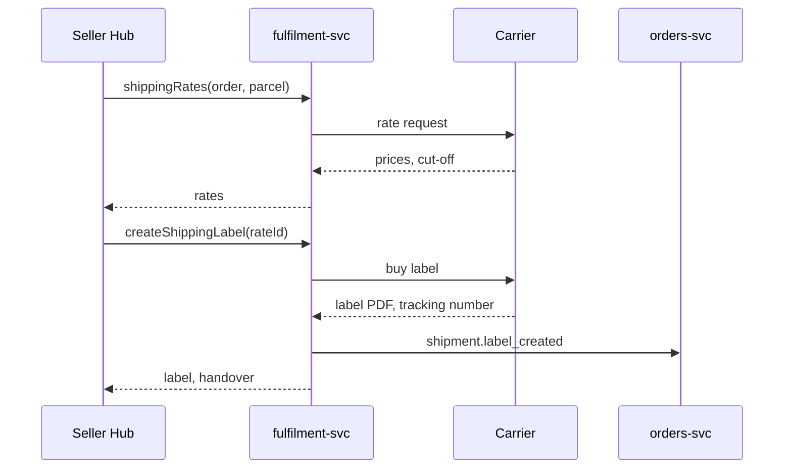

| Status | Stable |
| -- | -- |
| Version | 1.1 |
| Updated | 2026-08-18 |
| Owner | DemoMike |
| Applies to | Seller Hub, partner apps, `fulfilment-svc` |

## Overview

Sellers and their apps buy shipping labels for orders through one GraphQL API, served by Seller Hub's gateway and implemented in `fulfilment-svc`. The product reasoning is in [RFC-078](@RFC-078).

## Operations

| Operation | Kind | Purpose |
| -- | -- | -- |
| `shippingRates(orderId, parcel)` | query | Carriers, prices, delivery estimates and today's cut-off for a parcel |
| `createShippingLabel(input)` | mutation | Buy a label; returns the label and its tracking number |
| `createShippingLabels(input)` | mutation | Buy up to 100 labels in one call; returns one merged PDF |
| `voidShippingLabel(id)` | mutation | Cancel an unused label within 24 hours; the cost is credited |

## Schema

```graphql
input ParcelInput {
  weightGrams: Int!
  lengthMm: Int!
  widthMm: Int!
  heightMm: Int!
}

input CreateShippingLabelInput {
  orderId: ID!
  rateId: ID!
  parcel: ParcelInput!
  format: LabelFormat = PDF_A6
  idempotencyKey: String!
}

enum LabelFormat { PDF_A6 PDF_A4_FOUR_UP ZPL }

type ShippingLabel {
  id: ID!
  carrier: String!
  trackingNumber: String!
  format: LabelFormat!
  downloadUrl: String!
  cost: Money!
  voidableUntil: DateTime!
}

type Handover {
  cutoffAt: DateTime!
  nextCollectionAt: DateTime!
}
```

`downloadUrl` is signed and valid for 15 minutes; asking for the label again returns a new URL. `Money` is integer minor units with a currency ([ADR-020](@ADR-020)).

## Validation

| Field | Rule | Error code |
| -- | -- | -- |
| `orderId` | An order of this seller in state `paid` or `partially_shipped` ([SPEC-047](@SPEC-047)) | `order_not_shippable` |
| `rateId` | Returned by `shippingRates` in the last 30 minutes | `rate_expired` |
| `parcel.weightGrams` | 1 to 31,500, and within the carrier's limit | `parcel_too_heavy` |
| Dimensions | Each side 10 to 1,200 mm | `parcel_size` |
| `idempotencyKey` | Same rules as the public API ([SPEC-035](@SPEC-035)) | `idempotency_key_reused` |

## Flow



## Version history

| Version | Date | Change |
| -- | -- | -- |
| 1.0 | 2026-07-06 | First version |
| 1.1 | 2026-08-18 | Batch labels and ZPL format |
