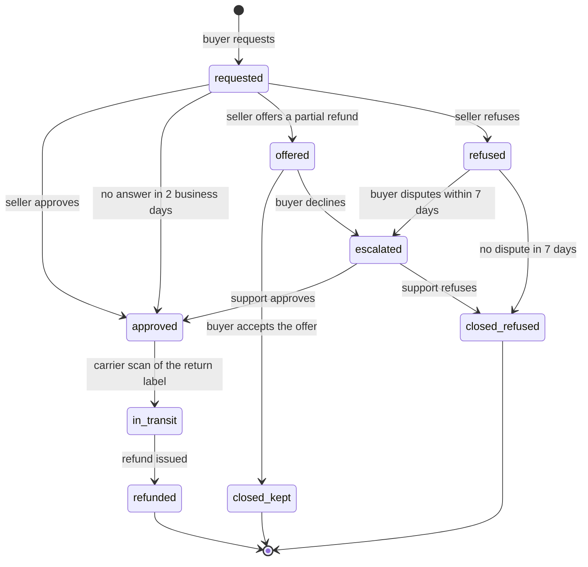

| Status | Draft |
| -- | -- |
| Version | 0.4 |
| Updated | 2026-08-11 |
| Owner | DemoErin |
| Applies to | `orders-svc`, Seller Hub returns page, the buyer's order page and app |

## Overview

The states, deadlines and allowed actions of a return request when the seller decides on it, as proposed in [RFC-080](@RFC-080). This is a draft: deadlines may change after the pilot.

## States



## Transitions

| From | To | Who | Deadline | Side effects |
| -- | -- | -- | -- | -- |
| `requested` | `approved` | seller, or automatic | 2 business days | Return label issued ([SPEC-083](@SPEC-083)) |
| `requested` | `offered` | seller | 2 business days | Buyer notified with the offer |
| `requested` | `refused` | seller | 2 business days | Reason required; not allowed for `damaged` or `not_as_described` with photos |
| `offered` | `closed_kept` | buyer | 5 days | Partial refund issued ([SPEC-050](@SPEC-050)) |
| `offered` | `escalated` | buyer | 5 days | Case opened for support |
| `refused` | `escalated` | buyer | 7 days | Case opened for support |
| `escalated` | `approved` or `closed_refused` | support | 3 business days | Counts against the seller if support overturns a refusal ([SPEC-082](@SPEC-082)) |
| `approved` | `in_transit` | carrier scan | 14 days | After 14 days without a scan the request closes |
| `in_transit` | `refunded` | automatic | immediately | Full refund minus any restocking fee |

## Request

| Field | Type | Required | Rule |
| -- | -- | -- | -- |
| `order_line_id` | string | yes | Delivered within the last 30 days |
| `quantity` | integer | yes | 1 to the quantity delivered, minus earlier returns |
| `reason` | enum | yes | `wrong_size`, `not_as_described`, `damaged`, `changed_mind`, `other` |
| `photos` | list of images | for `damaged`, `not_as_described` | 1 to 5 |
| `comment` | string | no | Up to 1,000 characters |

## Seller response

```graphql
enum ReturnDecision { APPROVE PARTIAL_REFUND REFUSE }

input RespondToReturnInput {
  returnRequestId: ID!
  decision: ReturnDecision!
  refund: MoneyInput
  restockingFeePercent: Int
  message: String
}
```

`refund` is required for `PARTIAL_REFUND` and must be below the line's price. `restockingFeePercent` is 0 to 10.

## Events

Each transition publishes `orders.return.<state>.v1` with the [event envelope](@SPEC-016), keyed by the order id so the return's events stay in order with the order's own events ([SPEC-017](@SPEC-017)).

## Version history

| Version | Date | Change |
| -- | -- | -- |
| 0.1 | 2026-07-14 | First draft |
| 0.3 | 2026-07-30 | Partial refund offers |
| 0.4 | 2026-08-11 | Refusal not allowed for damaged items with photos |
