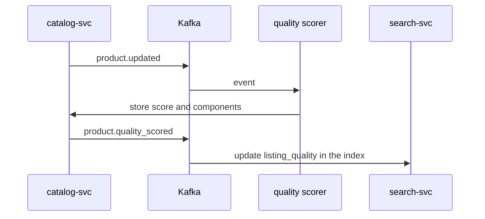

| Status | Stable |
| -- | -- |
| Version | 1.0 |
| Updated | 2026-07-27 |
| Owner | DemoOscar |
| Applies to | `catalog-svc`, Seller Hub listings, the search ranking features |

## Overview

Every listing has a quality score from 0 to 100: the sum of five components, each with a fixed maximum. The score is recomputed whenever the listing changes and once a day for the price component. The reasons and the evidence are in [RFC-081](@RFC-081) and [RN-071](@RN-071).

## Components

| Component | Max points | Points |
| -- | -- | -- |
| Photos | 30 | 6 per photo with a short side of at least 1,000 px, up to 5 photos; 3 per smaller photo |
| Attributes | 25 | 25 × filled required attributes ÷ required attributes; optional attributes add nothing |
| Title and description | 20 | Title of 30 to 120 characters: 8. Description of 300 characters or more: 8. No [validation warnings](@SPEC-079) on either: 4 |
| Price | 15 | Within 10 % of the category median for the product type: 15; within 25 %: 8; otherwise 0 |
| Shipping | 10 | Delivery estimate of 3 days or less: 6. Tracked shipping: 4 |

Points are rounded down per component; the score is their sum.

## Example

```json
{
  "listing_id": "lst_5821",
  "score": 69,
  "components": {
    "photos": { "points": 18, "max": 30, "detail": "3 large photos" },
    "attributes": { "points": 25, "max": 25 },
    "text": { "points": 12, "max": 20, "detail": "description of 140 characters" },
    "price": { "points": 8, "max": 15, "detail": "18 % above the category median" },
    "shipping": { "points": 6, "max": 10, "detail": "delivery in 2 days, untracked" }
  },
  "top_fix": { "component": "photos", "gain": 12, "message": "Add 2 more photos" }
}
```

`top_fix` is the component with the largest possible gain; on a tie, the earlier component in the table wins.

## Bands

| Band | Score | Shown in Seller Hub as |
| -- | -- | -- |
| Excellent | 81 to 100 | green |
| Good | 61 to 80 | blue |
| Fair | 41 to 60 | yellow |
| Poor | 0 to 40 | red, with the top fix |

## Where the score is used

* Seller Hub: on every listing, as a column of the [bulk editor](@RFC-074) and as a filter.
* Seller metrics: the average over active listings ([SPEC-082](@SPEC-082)).
* Search: the score is a feature `listing_quality` in the [ranking features](@SPEC-061); the model learns its weight.

## Computation



## Version history

| Version | Date | Change |
| -- | -- | -- |
| 0.9 | 2026-06-08 | Draft for review, four components |
| 1.0 | 2026-07-27 | Shipping component; bands |
