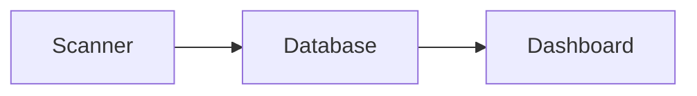

# Project brief: warehouse dashboard

## Problem

Stock levels are checked by hand twice a day.

## Proposal

A dashboard shows stock levels per site, updated every 15 minutes.

## Success measures

* Manual checks drop to once a week.
* Stock-outs fall by half.

Ref kx-0e7f8a0d